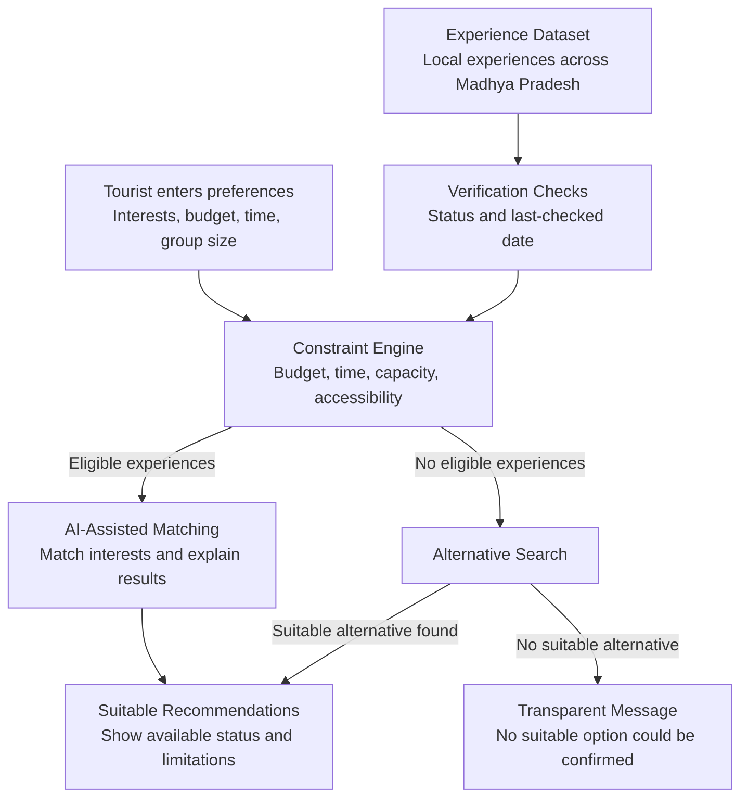

# LocalLens AI — Architecture Diagram

This diagram represents the proposed system workflow.
The application is not yet implemented.

## How it works

1. The tourist enters their preferences.
2. The system checks experience records and verification status.
3. The constraint engine filters unsuitable experiences.
4. AI helps explain relevant recommendations.
5. If no suitable option is found, the system searches for alternatives or clearly communicates the limitation.

## Important Design Principle

AI must not invent availability or treat unverified listings as confirmed. Essential constraints are checked separately from AI-generated explanations.
